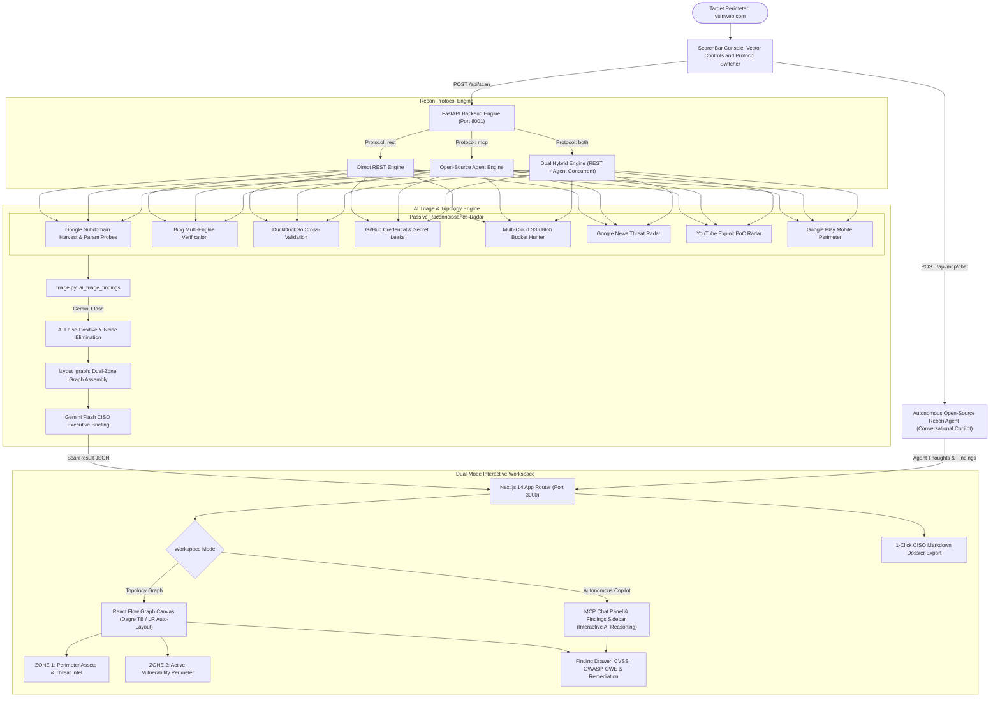

# 🛡️ ReconFlow AI
### Autonomous External Attack Surface Management & Threat Intelligence Agent

[](https://fastapi.tiangolo.com/)
[](https://nextjs.org/)
[](https://github.com/)
[](https://github.com/)
[](LICENSE)
[](https://github.com/)

**Cost to Run:** $0 / ₹0 (100% Free & Open-Source — No credit card or API subscriptions required)  
**Methodology:** 100% Pure Search Intelligence & Passive Reconnaissance (Multi-Engine Open-Source EASM)

---

## 📌 Executive Summary & Open-Source Intelligence Architecture

Engineering teams deploy microservices, cloud storage, and staging clusters faster than internal security operations can catalog them. This rapid iteration inevitably creates **Shadow IT**: forgotten staging subdomains, unauthenticated API documentation portals (`/swagger-ui`, `/graphiql`), exposed cloud storage buckets (AWS S3, Azure Blob, Google Cloud Storage), and misconfigured web roots exposing `.env` files or database dumps to public search engine crawlers.

ReconFlow AI provides a 100% autonomous, defensive External Attack Surface Management (EASM) agent built completely on **free, open-source search tools** (`googlesearch-python`, `duckduckgo_search`, `beautifulsoup4`). Given a target domain, ReconFlow executes a multi-engine reconnaissance sweep across **Google, DuckDuckGo, Videos, and News**. It categorizes risks under OWASP & CWE standards and renders the entire attack perimeter onto an **interactive, color-coded node graph with copy-paste defensive remediation playbooks and an autonomous conversational AI Copilot**.

---

## ⚖️ Ethical Boundary & Non-Intrusive Methodology

ReconFlow AI adheres to a strict defensive perimeter standard:

| What ReconFlow Does ✅ | What ReconFlow NEVER Does 🚫 |
| :--- | :--- |
| Queries public search indexes via open-source tools (Google, DuckDuckGo, Videos, News) | **Zero** exploitation payloads or remote code execution attempts |
| Discovers exposed cloud storage buckets (AWS S3, Azure Blob, GCS) via indexed search engines | **Zero** brute-force directory fuzzing or port scanning |
| Surfaces public leaked credentials and secrets indexed in public repos/code pastes | **Zero** socket connections or network probing against target infrastructure |
| Audits shadow IT documentation portals and exposed environment configurations | **Zero** disruptive traffic or denial-of-service simulations |

---

## 🎯 Demo Targets & Legal/Optics Hygiene

To maintain the highest legal and ethical hygiene during presentations, live audits, and video reviews:
1. **Primary Live Target:** `vulnweb.com` (industry-standard Acunetix vulnerable web testbed) — safely demonstrates live multi-engine discovery of realistic web exposures, SQL injection indicators, XSS parameters, and administrative consoles with zero ethical ambiguity.
2. **Production Baseline:** `reconflow.ai` / `reconflow.render.com` — demonstrates a hardened, secure perimeter exhibiting zero false positives and a clean **"Perimeter Secure"** Zone 2 posture.
3. **Offline Sandbox Mode:** Run with `demo-sandbox.corp` or offline cache — displays staged security anomalies without any external network traffic.

---

## 🏗️ System Architecture & Data Flow

ReconFlow AI operates using high-performance open-source search engines:
- **`OpenSearchClient`**: Unified search abstraction (`googlesearch-python`, `duckduckgo_search`, `beautifulsoup4`) with zero paid API dependencies.
- **`ProxyRotator`**: Self-healing proxy rotation pool with automated public mirror harvesting, threaded latency validation, round-robin dispatch, and circuit-breaker quarantine on HTTP 429/403.
- **`AutonomousMCPAgent`**: Autonomous reasoning agent dynamically formulating search dorks, invoking search tools, and analyzing telemetry.
- **Triple-Protocol Engine**: Dynamic protocol switching between **Direct REST (`rest`)**, **Open-Source Agent (`mcp`)**, and **Dual Hybrid (`both`)** with automatic link deduplication.
- **Multi-Engine Intelligence**: Cross-engine perimeter verification across Google Search, DuckDuckGo Web, DuckDuckGo News, and DuckDuckGo Videos.



---

## 📁 Repository & Directory Structure

```
reconflow.ai/
├── README.md                      # Primary project documentation & architecture guide
├── RENDER_DEPLOYMENT.md           # Step-by-step production deployment instructions for Render.com
├── render.yaml                    # Infrastructure-as-Code Blueprint for Render services
├── start_dev.sh                   # One-command development runner (FastAPI + Next.js)
├── changes.txt                    # Comprehensive architectural change log & feature history
├── .env.example                   # Environment configuration template
│
├── backend/                       # Python FastAPI Backend (Port 8001)
│   ├── requirements.txt           # Python dependencies (FastAPI, googlesearch-python, duckduckgo-search, beautifulsoup4, requests, pydantic)
│   ├── app/
│   │   ├── main.py                # FastAPI routes (scans, jobs, MCP chat, proxy rotation)
│   │   ├── schemas.py             # Pydantic data contracts (GraphNode, FindingMetadata, ScanResult)
│   │   ├── config.py              # Environment variable loader & proxy pool configuration
│   │   ├── cache.py               # Path-traversal-safe JSON cache reader/writer
│   │   ├── remediation.py         # OWASP & CWE defensive playbooks (NGINX, AWS, DNS)
│   │   └── services/
│   │       ├── phase1_domain.py   # Multi-engine search orchestrator (REST, Agent, and Hybrid)
│   │       ├── phase2_external.py # Cloud storage hunter (S3, Blob, GCS) & external threat radar
│   │       ├── mcp_agent.py       # Autonomous open-source agent reasoning & intent parser
│   │       ├── mcp_server.py      # Standardized MCP JSON-RPC 2.0 tool definitions
│   │       ├── job_manager.py     # File-backed multi-worker job persistence
│   │       ├── exposure_prober.py # Anti-false-positive prober with SPA soft-404 detection
│   │       ├── open_search_client.py # Unified open-source search engine client (Google, DDG)
│   │       ├── proxy_rotator.py   # Resilient proxy pool manager with circuit-breaker quarantine
│   │       └── triage.py          # Gemini Flash false-positive filter & CISO executive summarizer
│   ├── cache/                     # Offline fixtures & target cache (e.g., demo_mock.json)
│   └── tests/                     # Unit test suites (11/11 passing tests)
│
└── frontend/                      # Next.js 14 App Router Frontend (Port 3000)
    ├── package.json               # Frontend dependencies (@xyflow/react, lucide-react, three)
    ├── next.config.js             # SWC optimization & package import treeshaking
    ├── tailwind.config.js         # Security-grade dark theme design system & palette
    ├── app/
    │   ├── layout.tsx             # Root layout with font preloading & ThemeContext
    │   ├── page.tsx               # High-converting landing page with Hero, Open Source Architecture & Tech Radar
    │   ├── recon/page.tsx         # Unlimited reconnaissance workspace (Network Graph + MCP Copilot)
    │   └── globals.css            # Dark theme, React Flow styling, and custom animations
    ├── components/
    │   ├── HeroSection.tsx        # Hero section with live search input & target presets
    │   ├── SearchBar.tsx          # Scan console with Dork Matrix toggles & Protocol Switcher
    │   ├── GraphCanvas.tsx        # React Flow canvas with Dagre TB/LR orientation & fitView
    │   ├── MCPChatPanel.tsx       # Conversational AI copilot with live tool execution traces
    │   ├── MCPFindingsSidebar.tsx # Real-time findings overview, grade display & quick-drills
    │   ├── FindingDrawer.tsx      # Slide-out drawer with CVSS scores, CWE codes & copy-paste fixes
    │   ├── SummaryCards.tsx       # Borderless attack surface KPI cards with grade badges
    │   ├── ThoughtStream.tsx      # Terminal log stream displaying live search execution
    │   ├── OpenSourceSection.tsx  # Open-source architecture & commercial API comparison showcase
    │   ├── RemediationSection.tsx # Copy-paste defensive playbooks showcase
    │   └── nodes/                 # Standardized 240px custom graph nodes (Root, Asset, Finding, External)
    └── lib/
        ├── layout.ts              # Dagre automated graph layout calculation (TB / LR rankdir)
        ├── dossier.ts             # 1-Click CISO Executive Markdown dossier generator
        └── types.ts               # TypeScript data models mirroring backend Pydantic schemas
```

---

## 🔍 Resilient Multi-Engine Dorking Matrix

| Pass | Engine | Target Query / Syntax | Objective & Standard | Severity |
| :--- | :--- | :--- | :--- | :--- |
| **1.1** | `google` | `site:{target} -www.{target}` | Subdomain harvesting via Google index | `Info` / `Low` |
| **1.1b**| `bing` | `site:{target} -www.{target}` | Cross-engine subdomain verification | `Info` / `Low` |
| **1.1c**| `duckduckgo`| `site:{target} -www.{target}` | Independent index cross-validation | `Info` |
| **1.2** | `google` | `site:{target} (inurl:admin OR inurl:portal OR inurl:docs OR inurl:api)` | Unauthenticated documentation / portals (OWASP A01) | `Medium` |
| **1.3** | `google` | `site:{target} (filetype:env OR filetype:sql OR filetype:yaml OR filetype:bak)` | Sensitive configuration & database dumps (OWASP A05 / CWE-200) | `Critical` |
| **1.4** | `google` | `site:{target} inurl:id= OR inurl:cat= OR inurl:artist=` | Parameterized endpoint audit for SQL injection / XSS risks | `Medium` |
| **2.1** | `google` | `site:github.com "{target}" (filename:.env OR "BEGIN RSA PRIVATE KEY")` | Public code repository credential exposure (OWASP A07) | `Critical` |
| **2.2** | `google` | `(site:s3.amazonaws.com/{brand} OR site:storage.googleapis.com/{brand} OR site:*.blob.core.windows.net "{brand}")` | Multi-Cloud Storage Hunter: AWS S3, Azure Blob, GCS with light-touch RFC check | `Critical` / `High` |
| **2.3** | `google_news`| `"{brand}" (security OR vulnerability OR breach OR exploit)` | Real-time threat intelligence & incident alerts | `Info` |
| **2.4** | `youtube`| `"{brand} vulnerability" OR "{brand} exploit poc"` | Security researcher exploit video radar | `Info` |
| **2.5** | `google_play`| `q="{brand}"` | Mobile application perimeter assets | `Info` |
| **2.6** | `google` | User-defined custom query (e.g. `site:{target} inurl:grafana`) | **Ungated Dork Hunting**: Custom signatures with `{target}` and `{brand}` variables | `High` / `Med` |

---

## ✨ Key Features & Technical Highlights

### 1. Autonomous Recon Agent & Conversational Copilot
- **Live Agent Reasoning**: Integrated via `backend/app/services/mcp_agent.py` and `POST /api/mcp/chat`. Users can interact conversationally (e.g., *"Check for exposed S3 buckets"*, *"Look for credential leaks on GitHub"*, or *"Tell me how to remediate finding #1"*).
- **Dynamic Tool Dispatch**: The agent formulates targeted Google and DuckDuckGo Dork queries on the fly and calls the open-source search tools live.
- **Interactive UI**: `MCPChatPanel.tsx` displays real-time agent thoughts, tool execution badges, structured finding cards with direct remediation drawer triggers, and quick-prompt chips.

### 2. Triple Recon Protocol Support (REST, Agent, Both)
- **Direct REST (`rest`)**: Fast, parallel execution against open-source search engines.
- **Open-Source Agent (`mcp`)**: Native conversational agent query mode providing real-time reasoning and finding synthesis.
- **Dual Hybrid Engine (`both`)**: Simultaneously triggers REST and Agent queries, combining and deduplicating results across both protocols for maximum perimeter visibility.

### 3. Dual-Zone Topology Graph + Phase 2 Threat Radar
- **Zone 1: Assets & Intel** — Apex domains, subdomains, mobile applications, and YouTube researcher PoCs.
- **Zone 2: Vulnerability Perimeter** — Critical and high-risk exposures (unauthenticated APIs, exposed `.env` files, SQL/XSS parameters, missing DMARC/SPF).
- **Layout Direction Toggle**: Switch between **Vertical** (top-to-bottom) and **Horizontal** (left-to-right) orientations instantly with Dagre auto-layout and automatic canvas framing (`fitView`).

### 4. Sovereign, Frictionless Reconnaissance Architecture
Direct, unauthenticated reconnaissance scanning following open-source EASM standards (Amass, Sublist3r, theHarvester). Zero fake client-side verification gates, zero third-party telemetry, and instant unblocked scans.

### 5. Multi-Cloud Bucket Hunter with RFC Verification
Searches across **AWS S3, Azure Blob Storage, Google Cloud Storage, and DigitalOcean Spaces**. Inspects response headers non-intrusively to distinguish public open directory listings (`<ListBucketResult>`) from restricted (`403 AccessDenied`) assets.

### 6. 100% Free & Open-Source — Zero Paywall, Zero Authorization
ReconFlow AI is engineered as an unrestricted, plug-and-play External Attack Surface Management engine:
- **$0 / Free Forever (MIT)**: Zero paywalls, zero pricing tiers, zero accounts. Simply clone and use.
- **Zero Authentication & Authorization**: No login, sign-up, or work email verification barriers.
- **Unlimited Recon Scans**: No artificial monthly search caps, credit limits, or overage charges.
- **Self-Healing Proxy Rotation Shield**: Built-in multi-source proxy rotation pool (`backend/app/services/proxy_rotator.py`) with sub-second Google 204 pre-flight validation and circuit breaker auto-quarantine on HTTP 429.
- **Data Sovereignty & Zero Logging**: Runs 100% on your local infrastructure with zero external telemetry or query retention.
- **Multi-Engine Correlation**: Concurrently sweeps Google, DuckDuckGo (Web, News, Videos), and crt.sh in parallel threads, synthesizing intelligence into an interactive Dagre DAG graph.

### 7. 1-Click CISO Executive Markdown Dossier Export
Generates an executive CISO dossier containing the executive briefing, numeric security posture score (0–100), letter grade (A–F), threat intelligence radar, and copy-paste remediation playbooks (NGINX, AWS CLI, git-filter-repo, SPF/DMARC).

### 8. Resilient Self-Healing Proxy Rotation Shield
- **Zero-Config Auto-Harvesting**: Scrapes verified, high-anonymity public HTTP/SOCKS proxies, alongside user-defined lists in `backend/proxies.txt` or `PROXY_LIST` in `.env`.
- **Pre-Flight Health Benchmarking**: Concurrently verifies candidate nodes via parallel Google connectivity pings.
- **Circuit Breaker Quarantine**: Rate-limited or timing-out nodes (HTTP 429/403) are placed on 5-minute quarantine with automatic retry.
- **Zero-Failure Direct Fallback**: Automatically falls back to direct connection if all proxies are exhausted, ensuring scans never fail.

---

## 📡 Complete REST & MCP API Reference

| Method | Endpoint | Description | Request Payload | Response Summary |
| :--- | :--- | :--- | :--- | :--- |
| `GET` | `/` | Root API service information & routes | None | JSON service metadata & version |
| `GET` | `/health` | Service health & MCP readiness probe | None | `{"status": "ok", "mcp_enabled": true}` |
| `POST` | `/api/scan` | Execute autonomous attack surface sweep | `{domain, protocol, enable_phase2, use_cache, custom_dorks, enabled_vectors}` | Complete `ScanResult` JSON with nodes, edges, thoughts, and summary |
| `POST` | `/api/scan/jobs` | Background asynchronous scan job dispatcher | `{domain, protocol, ...}` | Job ID and status for multi-worker polling |
| `GET` | `/api/scan/jobs/{id}`| Poll background scan job status & result | None (Path param) | Job progress, status, and completed `ScanResult` |
| `POST` | `/api/mcp/chat` | Autonomous Recon Agent Copilot | `{domain, message, existing_nodes}` | Agent reasoning, tool calls, and discovered findings |
| `POST` | `/api/mcp/rpc` | Standardized MCP JSON-RPC 2.0 gateway | `{"jsonrpc": "2.0", "method": "tools/call", ...}` | RFC-compliant tool execution results |
| `GET` | `/api/mcp/tools` | Enumerate available MCP reconnaissance tools | None | JSON schema definitions of all 5 tools |
| `GET` | `/api/cache/{domain}` | Retrieve cached scan dossier | None (Path param) | Stored `ScanResult` JSON |
| `GET` | `/api/remediation` | Retrieve all defensive playbooks | None | OWASP / CWE remediation playbooks dictionary |
| `GET` | `/api/engines` | Active reconnaissance engines & proxy status | None | Engine status & proxy metrics dictionary |
| `GET` | `/api/proxies/status` | Current proxy pool health and metrics | None | Active, quarantined, and total proxy metrics |
| `POST` | `/api/proxies/refresh` | Force proxy pool re-harvest & verification | None | Background refresh status confirmation |

---

## ⏱️ 3-Minute (180s) Video Rehearsal Script

| Timestamp | Phase | Visual / Screen Action | Spoken Narrative & Value Proposition |
| :--- | :--- | :--- | :--- |
| **0:00 – 0:25** | **The Hook** | Dashboard hero with Three.js particle wave and protocol selector. | *"Enterprises deploy faster than security teams can catalog. Forgotten subdomains and staging APIs leak into search engines. ReconFlow AI makes autonomous attack surface reconnaissance possible with 100% open-source tools."* |
| **0:25 – 0:50** | **The Launch & Protocols** | Select `vulnweb.com`, showcase Protocol Switcher (REST / Recon Agent / Dual Hybrid). | *"ReconFlow AI runs 100% passive search intelligence. We select our execution mode: Direct REST, Open-Source Recon Agent, or Dual Hybrid to run both concurrently with zero invasive traffic."* |
| **0:50 – 1:40** | **Multi-Engine Intelligence** | Watch Thought Stream stream through Google, DuckDuckGo, Videos, and News. | *"Watch ReconFlow sweep open search engines: Google and DuckDuckGo harvest subdomains and validate independently, video indexes flag exploit PoCs, and multi-cloud bucket hunting identifies storage leaks."* |
| **1:40 – 2:20** | **Interactive Graph & Remediation** | Switch Vertical $\rightarrow$ Horizontal layout, click finding node for drawer. | *"Zone 1 maps assets, Zone 2 isolates vulnerabilities. Clicking any finding displays CVSS scoring, CWE mappings, and copy-paste remediation playbooks for NGINX, AWS policies, and DNS records."* |
| **2:20 – 2:45** | **Autonomous Agent Chat** | Switch to Copilot tab, prompt *"Check for S3 buckets"*. | *"Here is our Autonomous Recon Agent. It reasons over user intent, executes open-source search tools live, and investigates attack vectors conversationally."* |
| **2:45 – 3:00** | **The Finish** | Click **Export Dossier**, highlight letter grade & Markdown report. | *"One click exports an executive CISO dossier. 100% autonomous, $0 to run, powered by open-source search tools. Thank you!"* |

---

## ⚙️ Environment Variables

Create a `.env` file in the root or `backend/` directory:

| Variable | Required? | Default | Description |
| :--- | :--- | :--- | :--- |
| `ENABLE_PROXY_ROTATION` | Optional | `true` | Enable built-in self-healing proxy rotation pool. |
| `PROXY_LIST` | Optional | `""` | Comma-separated list of custom HTTP/SOCKS proxies. |
| `GEMINI_API_KEY` | Optional | `""` | Google Gemini API key for dynamic AI CISO executive summaries and triage. |
| `HOST` | Optional | `0.0.0.0` | Backend bind host. |
| `PORT` | Optional | `8001` | Backend port number. |
| `NEXT_PUBLIC_API_URL` | Optional | `http://localhost:8001` | Frontend target API URL. |

---

## 🚀 Local Setup & Quickstart

### Prerequisites
- Python 3.9+
- Node.js 18+ (tested on Node v20/v22/v25)

### Option A: Automated One-Command Launcher (macOS / Linux)
```bash
chmod +x start_dev.sh
./start_dev.sh
```

### Option B: Manual Step-by-Step

#### 1. Backend Setup
```bash
cd backend
python3 -m venv .venv
source .venv/bin/activate  # On Windows: .venv\Scripts\activate
pip install -r requirements.txt
python3 -m uvicorn app.main:app --reload --port 8001
```
*Health Check*: Open `http://localhost:8001/health` $\rightarrow$ `{"status": "ok", "service": "ReconFlow AI EASM Agent"}`

#### 2. Frontend Setup
```bash
cd frontend
npm install
npm run dev
```
*UI Access*: Open `http://localhost:3000` in your browser.

---

## ☁️ Deployment Guide

ReconFlow AI is production-ready for deployment to **Render.com** using the included `render.yaml` Blueprint or manual web services. See [RENDER_DEPLOYMENT.md](./RENDER_DEPLOYMENT.md) for full instructions.

---

## 📄 License
MIT License. Autonomous Open-Source External Attack Surface Management.
